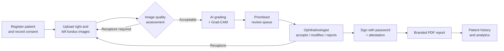
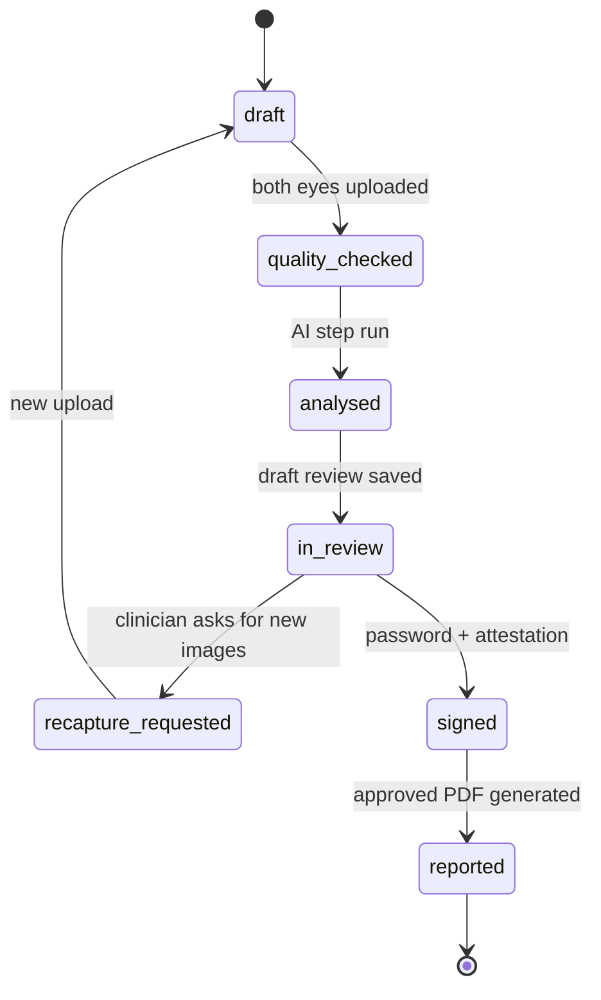
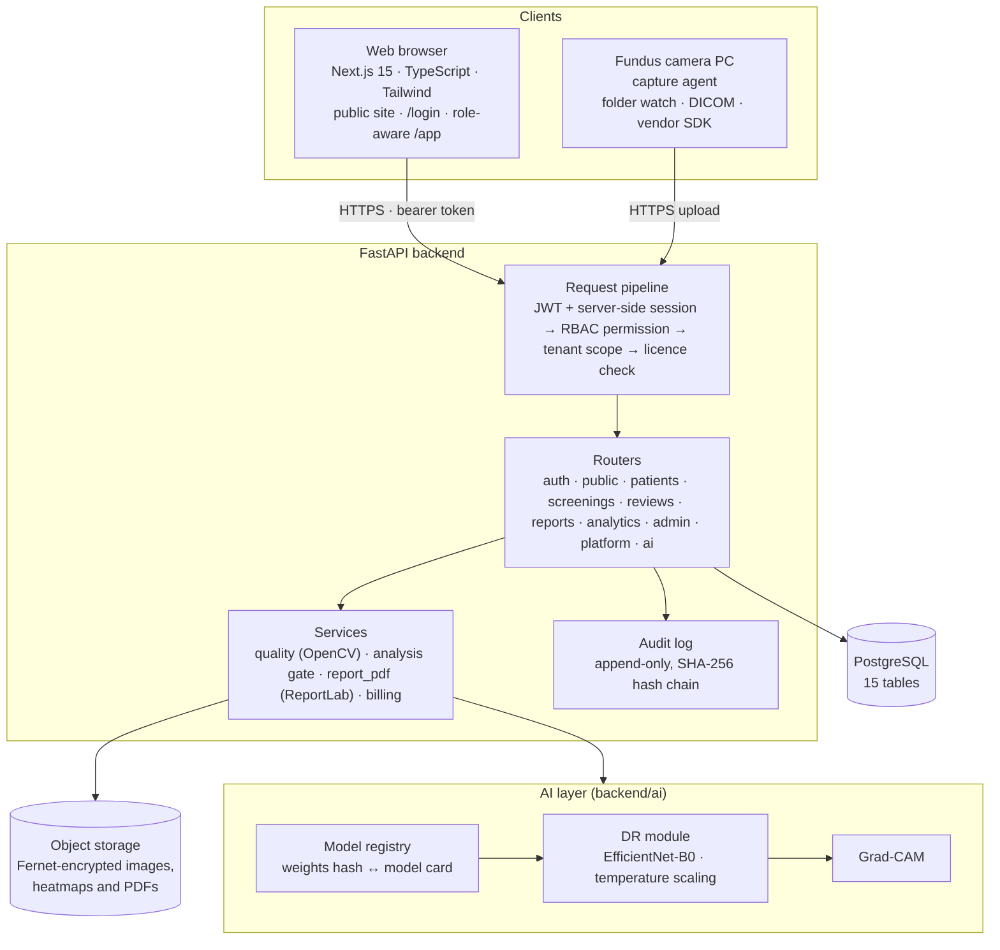
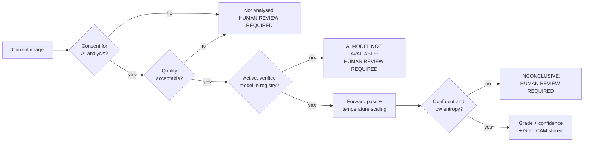
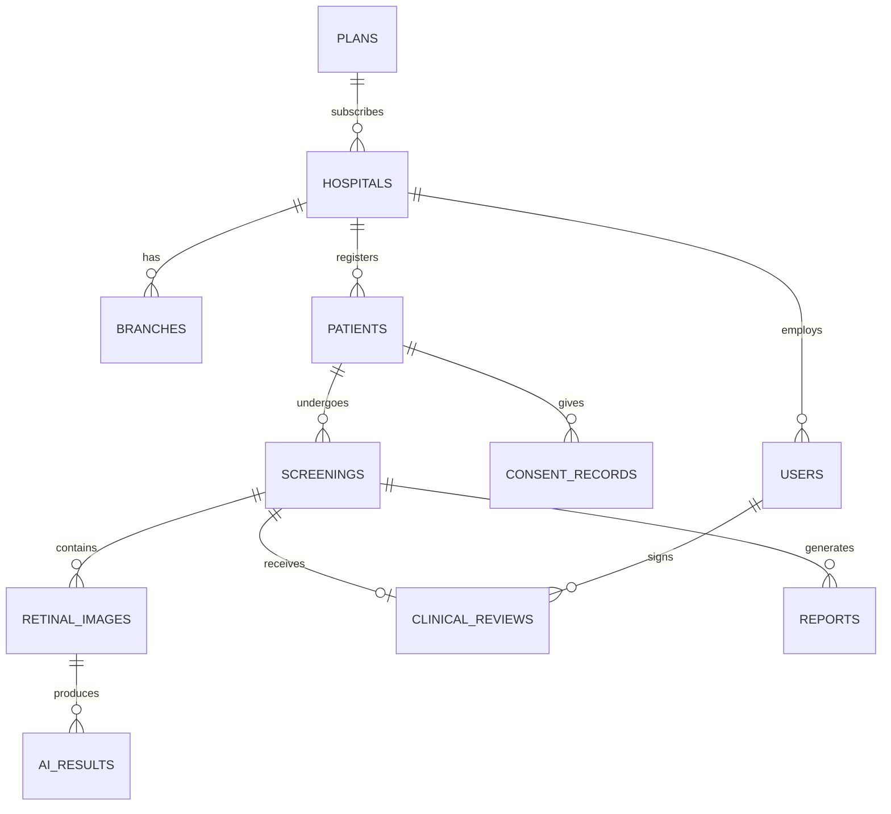

# NetraRakshak

**See Beyond the Retina. Detect Earlier. Protect Vision.**

NetraRakshak is an AI-assisted retinal screening platform for hospitals, eye clinics and diagnostic centres. A
technician photographs both eyes with a fundus camera. The platform checks that the images are good enough to grade,
runs a trained diabetic retinopathy (DR) model with calibrated confidence and a Grad-CAM heatmap, and passes the case
to an ophthalmologist. The ophthalmologist reviews and signs, and the hospital receives a branded PDF report. Every
decision about a patient is made by a clinician; the AI is a second reader that helps prioritise and explain.

Live demo (synthetic data only): https://netrarakshak.vercel.app

> **Status: v0.9 pre-release, investigational.** The diabetic retinopathy model is trained and active
> (EfficientNet-B0 v2026.11.11-1219, APTOS 2019). It is **not clinically validated** and **not approved by CDSCO or
> any other regulator**, and APTOS commercial-use terms are unconfirmed. Use synthetic or consented research data only.

---

## Contents
- [Why NetraRakshak](#why-netrarakshak)
- [Screening workflow](#screening-workflow)
- [Features](#features)
- [Architecture](#architecture)
- [The diabetic retinopathy model](#the-diabetic-retinopathy-model)
- [Security, privacy and compliance](#security-privacy-and-compliance)
- [Technology stack](#technology-stack)
- [Roles and permissions](#roles-and-permissions)
- [Limitations and roadmap](#limitations-and-roadmap)
- [Documentation](#documentation)

---

## Why NetraRakshak

India has more than 100 million people living with diabetes, and diabetic retinopathy is a leading cause of
preventable blindness. Early DR has no symptoms, and screening programmes are limited by the small number of
ophthalmologists. NetraRakshak lets trained technicians capture and quality-check fundus images at the point of care,
uses AI to grade them and flag the referable cases first, and keeps the ophthalmologist in control of every report.

## Screening workflow

Each screening moves through a fixed sequence of states, and a signed screening is locked against new images and
edits:

## Features

**Patient management.** Unique patient IDs, demographics and diabetes history, consent records with withdrawal,
search and filters, editing, archiving and right-to-erasure handling.

**Retinal image upload.** Right (OD) and left (OS) eye drag-and-drop for JPEG, PNG and TIFF, with previews, metadata
and EXIF capture, SHA-256 fingerprints and encrypted storage. A replaced image is kept in its history rather than
deleted. A reference camera agent watches the capture PC's export folder and uploads new images automatically.

**Image quality assessment.** Every image is checked automatically for resolution, retinal visibility, field of view,
fundus plausibility, brightness, contrast, exposure clipping, blur, focus and artefacts. The result is
**Acceptable**, **Recapture required** or **Inconclusive**, with a plain-language reason for each failed check, so the
technician can retake the photo while the patient is still in the room.

**AI grading.** A five-grade DR classification (no apparent DR, mild, moderate, severe NPDR, proliferative DR) with
temperature-calibrated confidence and a referable/non-referable flag. A case is marked
`INCONCLUSIVE — HUMAN REVIEW REQUIRED` when confidence is low or the prediction is uncertain.

**Explainability.** A Grad-CAM overlay and heatmap are stored with every result and shown in the viewer and the PDF.
They are labelled as model attention maps, not clinical findings.

**Clinician review.** A separate ophthalmologist workspace with a queue ordered by AI urgency. The ophthalmologist
can accept, modify or reject the AI grade, add observations, make a referral or request recapture, and sign with
their password and an attestation. The original AI output is never changed; the clinician's interpretation is
stored separately.

**PDF reporting.** A hospital-branded A4 report with patient details, images, quality results, AI output, Grad-CAM,
the clinician's findings and signature. It carries a DRAFT watermark until signed, and every version is kept.

**Multi-hospital SaaS.** Strict tenant isolation, branches, hospital logo and colours, Starter, Professional and
Enterprise plans with usage limits, licence status and expiry enforcement, GST invoices and a platform super-admin
console.

**Analytics.** A dashboard of daily screening volume, screening status, referrals, image quality outcomes and median
turnaround time from registration to signed report.

## Architecture

NetraRakshak has three tiers: a Next.js web application, a FastAPI backend with the AI layer in the same process, and
a database plus encrypted object storage. Fundus cameras connect through a capture agent on the camera PC.

### Frontend
The Next.js App Router serves the public marketing site (landing page with an interactive 3D eye, technology,
solutions, security, contact and demo request) and the authenticated application of 18 screens. Navigation and
actions follow the user's role. API calls carry a short-lived bearer token, and a strict Content Security Policy only
lets the browser talk to the configured API.

### Backend request pipeline
Every authenticated request passes through the same layers before reaching any data:

1. **Authentication.** The JWT access token (30 minutes) is validated, then checked against a server-side session row
   so sessions can be revoked. Refresh sessions rotate on use. Accounts lock after repeated failed logins.
2. **Authorisation.** The user's role is checked against the permission matrix for the requested action.
3. **Tenant scope.** Queries are filtered to the user's hospital. A row that belongs to another tenant returns
   **404**, so its existence is not revealed. The platform super-admin has no hospital and cannot read patient data.
4. **Licence check.** Hospitals with an expired or suspended licence cannot start new screenings or run AI analysis.
5. **Audit.** Every change writes an append-only, hash-chained audit entry recording who, what, which record and the
   source IP, without patient data values.

### AI analysis gate
The analysis service runs each current image through a series of gates. A failed gate stores a result with a clear
reason instead of a grade:

The registry only loads a model when its weights hash matches the model card, held-out test metrics are present and
it was not trained on synthetic data. Models trained on synthetic data for automated tests are blocked from patient
use.

### Data model
The main tables are `plans`, `hospitals`, `branches`, `users`, `user_sessions`, `patients`, `consent_records`,
`screenings`, `retinal_images`, `ai_results`, `clinical_reviews`, `reports`, `audit_logs`, `demo_requests` and
`invoices`.

AI results are immutable. The clinician's interpretation lives in `clinical_reviews`, so the AI output and the
human decision can always be compared. Replaced images stay in `retinal_images` with `is_current = false`.

### Storage
Images, Grad-CAM heatmaps and PDF reports are encrypted with Fernet (AES-128-CBC with HMAC-SHA256) before being
written. They can be stored on the local disk or in a private S3-compatible bucket with server-side encryption on top.
The SHA-256 of every image and report is recorded so tampering can be detected.

### Camera integration
The capture agent defines a common `CaptureSource` interface. Folder watch works with most desktop fundus cameras
today. DICOM (C-STORE or DICOMweb STOW-RS for Ophthalmic Photography objects) and manufacturer SDKs plug into the same
interface but need the vendor's SDK and documentation. Phone cameras are not fundus cameras, and their images fail
the fundus-plausibility and retinal-visibility checks.

### Disease modules
Each disease is a separate module with its own data, model card and activation, producing its own AI results. There
is no generic "detect everything" model. Diabetic retinopathy is active. Glaucoma, age-related macular degeneration,
hypertensive retinopathy and other abnormalities are declared with their data requirements but deliberately not
activated until each has its own trained and evaluated model.

## The diabetic retinopathy model

| Item | Value |
|---|---|
| Model | NR-DR-efficientnet_b0, version 2026.11.11-1219 |
| Architecture | EfficientNet-B0 with ImageNet initialisation, 384 × 384 input |
| Preprocessing | Crop to retina, pad to square, resize, Ben Graham local-average subtraction, ImageNet normalisation |
| Training data | APTOS 2019 Blindness Detection (Kaggle), 3,662 images |
| Split | 2,615 train / 523 validation / 524 test, stratified by grade |
| Training | Weighted loss for class imbalance, early stopping on validation quadratic weighted kappa (best 0.887 at epoch 8) |
| Calibration | Temperature scaling (T = 0.771) fitted on the validation set |

Results on the held-out test set (n = 524):

| Metric | Value |
|---|---|
| Accuracy | 81.9% |
| Quadratic weighted kappa | 0.876 |
| Macro ROC-AUC (one-vs-rest) | 0.917 |
| **Referable DR** (moderate NPDR or worse): sensitivity / specificity | **82.0% / 96.6%** |
| Referable DR: PPV / NPV / ROC-AUC | 93.9% / 89.3% / 0.981 |
| Expected calibration error, before → after calibration | 12.2% → 6.1% |

At this operating point 37 of 205 referable eyes (18%) were graded non-referable, mostly moderate graded as mild.
Severe NPDR and proliferative DR have few test images and weaker performance. This is why every case goes to an
ophthalmologist and the model must never be used to rule out disease. Full figures, the confusion matrix and the
evaluation method are in [`docs/regulatory/05_model_evaluation.md`](docs/regulatory/05_model_evaluation.md).

## Security, privacy and compliance

- **Passwords and sessions:** bcrypt hashing, account lockout, revocable server-side sessions and rotating refresh
  tokens.
- **Access control:** five roles with a least-privilege permission matrix, strict per-hospital data isolation, and a
  platform operator who cannot see patient data.
- **Encryption:** TLS in transit; images, heatmaps and reports encrypted at rest with integrity hashes.
- **Audit:** append-only, SHA-256 hash-chained audit log of every change.
- **Consent:** AI analysis only runs when the patient has given consent for it; withdrawal and erasure are supported.
- **Web hardening:** Content Security Policy, HSTS, `X-Frame-Options`, `nosniff`, a no-referrer policy and `no-store`
  on API responses; stack traces are never returned to clients.
- **Regulatory pack:** intended use, risk management, software requirements, clinical validation plan, model
  evaluation, dataset documentation, cybersecurity, technical documentation, user manual and verification and
  validation, written with India's Digital Personal Data Protection Act and CDSCO medical-device software rules in
  mind ([`docs/regulatory/`](docs/regulatory/)).
- **Testing:** 30 backend tests cover authentication and permissions, tenant isolation, patients, upload and
  quality, AI inference and review and reporting. A browser end-to-end test runs the full acceptance workflow.

## Technology stack

| Layer | Technologies |
|---|---|
| Frontend | Next.js 15, React 19, TypeScript, Tailwind CSS, Radix UI, Recharts, Three.js |
| Backend | Python, FastAPI, Pydantic, SQLAlchemy 2, Gunicorn with Uvicorn workers |
| Database | PostgreSQL (SQLite for local development and tests) |
| AI | PyTorch, torchvision (EfficientNet-B0), OpenCV, NumPy, Grad-CAM, temperature scaling |
| Reports | ReportLab |
| Security | bcrypt, PyJWT, cryptography (Fernet) |
| Hosting | Vercel (website), Render (API and model) |

## Roles and permissions

| Role | What they can do |
|---|---|
| Platform super-admin | Manage hospitals, plans and licences; read the platform audit log. No access to patient data. |
| Hospital administrator | Everything within their hospital: patients, screenings, reports, analytics, users, branches, branding and audit. |
| Ophthalmologist | Patients and screenings, run AI, review and sign, generate reports, view analytics. |
| Screening technician | Register patients, record consent, upload images, run quality checks and AI, view reports. |
| Receptionist | Register patients, record consent, view screenings and reports. |

## Limitations and roadmap

- **Clinical validation:** prospective validation with partner hospitals and regulatory classification are needed
  before any clinical use.
- **Data rights:** confirm APTOS commercial terms or retrain on licensed partner-hospital data.
- **Model:** external validation (IDRiD, Messidor-2, partner data), an out-of-distribution detector (the current
  model can give confident grades to images that are not real retinas), and uncertainty thresholds tuned on
  validation data.
- **Image quality:** calibrate thresholds per camera model against clinician gradability labels.
- **Platform:** multi-factor authentication and SSO, rate limiting, database migrations, httpOnly cookie sessions,
  a payment gateway, DICOM and vendor SDK camera adapters, and the additional disease modules.

## Documentation

- [Architecture](docs/architecture.md)
- [Datasets](docs/datasets.md)
- [Regulatory documentation](docs/regulatory/)
- [IEEE-format project report](report/netrarakshak_ieee.pdf)
- [Sample report (synthetic patient)](docs/screenshots/SAMPLE_REPORT_SYNTHETIC.pdf)
- [Project status](PROJECT_STATUS.md)
